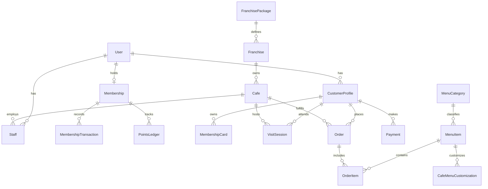

# UniCafe — Database Architecture & Schema Specification

This document details the MongoDB 7.0 database schema, collection definitions, indexing strategies, relationships, and data validation rules for the UniCafe platform.

---

## 🏛️ Schema Overview & Entity Relationship



---

## 📦 Collections Catalog

The UniCafe database contains 18 collections:

| Collection Name | Model Class | Primary Function |
| :--- | :--- | :--- |
| `users` | `User` | User identity, credentials, roles, and status |
| `customerprofiles`| `CustomerProfile` | Customer metadata, code (`UCxxxx`), preferences |
| `memberships` | `Membership` | Points balance, remaining minutes, recharge counters |
| `membershiptransactions` | `MembershipTransaction` | High-level ledger of purchases, recharges, and usage |
| `pointsledgers` | `PointsLedger` | Double-entry points transaction ledger (`CREDIT`, `DEBIT`, `REFUND`)|
| `cafes` | `Cafe` | Cafe branches, geolocations, operating hours, scopes |
| `franchises` | `Franchise` | Franchise entities, royalty rates, legal contracts |
| `franchisepackages` | `FranchisePackage` | Franchise tiers (Silver, Gold, Platinum) and fees |
| `staffs` | `Staff` | Staff designations, cafe assignments, shifts |
| `menucategories` | `MenuCategory` | Food & drink taxonomy (Espresso, Brews, Pastries) |
| `menuitems` | `MenuItem` | Global & local catalog items, pricing in points |
| `cafemenucustomizations` | `CafeMenuCustomization` | Local cafe item availability and price overrides |
| `orders` | `Order` | Food orders, preparation states, total points |
| `orderitems` | `OrderItem` | Line items linked to orders and menu items |
| `payments` | `Payment` | Inbound financial transactions (Razorpay & Demo) |
| `membershipcards` | `MembershipCard` | Contactless NFC/RFID cards, UIDs, and lifecycle status |
| `visitsessions` | `VisitSession` | Check-in/check-out cafe visits with minute deductions |
| `notifications` | `Notification` | In-app alerts, email/SMS dispatch logs |
| `auditlogs` | `AuditLog` | Immutable audit records for sensitive administrative operations |
| `systemsettings` | `SystemSetting` | Central platform business parameters & thresholds |

---

## 🗃️ Detailed Collection Specifications

### 1. `users`
Represents all system actors across the 6 roles.

```typescript
{
  _id: ObjectId,
  name: string,             // Full Name
  email: string,            // Unique, lowercase
  mobile: string,           // Unique, 10-digit Indian standard
  passwordHash: string,     // bcrypt (10 rounds)
  role: "SUPER_ADMIN" | "SUPERVISOR" | "FRANCHISE_OWNER" | "CAFE_MANAGER" | "CAFE_STAFF" | "CUSTOMER",
  status: "ACTIVE" | "INACTIVE" | "SUSPENDED",
  tokenVersion: number,     // For instant session invalidation
  lastLoginAt: Date,
  createdAt: Date,
  updatedAt: Date
}
```
- **Indexes:**
  - `{ email: 1 }` (unique)
  - `{ mobile: 1 }` (unique)
  - `{ role: 1, status: 1 }`

---

### 2. `memberships`
Holds the customer's wallet balance and cafe time allocation.

```typescript
{
  _id: ObjectId,
  customer: ObjectId,       // References users._id
  status: "ACTIVE" | "EXHAUSTED" | "INACTIVE" | "EXPIRED",
  pointsBalance: number,    // Current wallet points (1 pt = ₹1)
  remainingMinutes: number, // Remaining usage time (150h = 9,000 mins)
  totalPointsCredited: number,
  totalPointsSpent: number,
  totalMinutesUsed: number,
  rechargeCount: number,    // Total successful recharges
  activatedAt: Date,
  lastRechargeAt: Date,
  lowPointsNotifiedAt: Date,
  lowHoursNotifiedAt: Date,
  createdAt: Date,
  updatedAt: Date
}
```
- **Indexes:**
  - `{ customer: 1 }` (unique)
  - `{ status: 1 }`

---

### 3. `pointsledgers`
Immutable double-entry ledger. Every wallet point balance change MUST correspond to a document in this collection.

```typescript
{
  _id: ObjectId,
  customer: ObjectId,       // References users._id
  type: "CREDIT" | "DEBIT" | "REFUND" | "ADJUSTMENT",
  source: "RECHARGE" | "ORDER" | "REFUND" | "PROMOTION" | "ADMIN_ADJUSTMENT",
  points: number,           // Positive integer
  balanceBefore: number,
  balanceAfter: number,
  refModel: "Payment" | "Order" | "User",
  refId: ObjectId,          // Order or Payment ID
  reference: string,        // e.g. "ORD-202610-1001" or "PAY-..."
  description: string,
  isDemo: boolean,
  createdAt: Date
}
```
- **Indexes:**
  - `{ customer: 1, createdAt: -1 }`
  - `{ refId: 1, source: 1 }`

---

### 4. `membershipcards`
Manages contactless NFC/RFID smart cards.

```typescript
{
  _id: ObjectId,
  customer: ObjectId,       // References users._id
  cardNumber: string,       // e.g. "UCM-2026-1001"
  uid: string,              // Physical NFC/RFID UID (e.g. "NFC-IND-001")
  cardType: "PHYSICAL_RFID" | "PHYSICAL_NFC" | "DIGITAL_QR",
  status: "ACTIVE" | "BLOCKED" | "LOST" | "REPLACED" | "INACTIVE",
  issuedAt: Date,
  lastUsedAt: Date,
  lastTapAt: Date,          // For duplicate tap debouncing
  createdAt: Date,
  updatedAt: Date
}
```
- **Indexes:**
  - `{ uid: 1 }` (unique, sparse)
  - `{ cardNumber: 1 }` (unique)
  - `{ customer: 1 }` (unique partial filter `{ status: "ACTIVE" }` — enforces single active card rule)

---

### 5. `visitsessions`
Tracks live and historical cafe visits.

```typescript
{
  _id: ObjectId,
  customer: ObjectId,       // References users._id
  membership: ObjectId,     // References memberships._id
  card: ObjectId,           // References membershipcards._id
  cafe: ObjectId,           // References cafes._id
  status: "ACTIVE" | "COMPLETED" | "FORCE_CLOSED" | "CANCELLED",
  entryAt: Date,
  entryCafe: ObjectId,
  entryDevice: string,
  entryBy: ObjectId,        // Staff member who processed tap
  exitAt: Date,
  exitCafe: ObjectId,
  exitDevice: string,
  exitBy: ObjectId,
  minutesConsumed: number,  // Deducted from membership
  minutesBefore: number,
  minutesAfter: number,
  isDemo: boolean,
  createdAt: Date,
  updatedAt: Date
}
```
- **Indexes:**
  - `{ customer: 1, status: 1 }` (enforces customer can only have one ACTIVE visit)
  - `{ cafe: 1, entryAt: -1 }`
  - `{ entryAt: -1 }`

---

### 6. `orders` & `orderitems`
Captures dining orders paid with wallet points.

```typescript
// orders
{
  _id: ObjectId,
  orderNumber: string,      // e.g. "ORD-20261031-1001"
  customer: ObjectId,       // References users._id
  cafe: ObjectId,           // References cafes._id
  orderType: "IN_CAFE" | "PRE_ORDER",
  status: "PENDING" | "ACCEPTED" | "PREPARING" | "READY" | "COMPLETED" | "CANCELLED",
  totalPoints: number,      // Sum of item points
  totalItems: number,
  tableNumber: string,
  notes: string,
  idempotencyKey: string,   // Prevents duplicate orders
  placedAt: Date,
  acceptedAt: Date,
  readyAt: Date,
  completedAt: Date,
  cancelledAt: Date,
  cancelReason: string,
  refundLedgerId: ObjectId, // If refunded
  createdAt: Date,
  updatedAt: Date
}

// orderitems
{
  _id: ObjectId,
  order: ObjectId,          // References orders._id
  menuItem: ObjectId,       // References menuitems._id
  name: string,
  quantity: number,
  pointsPrice: number,      // Unit points price at purchase time
  totalPoints: number       // quantity * pointsPrice
}
```
- **Indexes:**
  - `{ orderNumber: 1 }` (unique)
  - `{ idempotencyKey: 1 }` (unique, sparse)
  - `{ customer: 1, placedAt: -1 }`
  - `{ cafe: 1, status: 1, placedAt: -1 }`

---

### 7. `payments`
Tracks all monetary transactions for membership purchase and recharge.

```typescript
{
  _id: ObjectId,
  customer: ObjectId,       // References users._id
  purpose: "MEMBERSHIP_PURCHASE" | "MEMBERSHIP_RECHARGE",
  amount: number,           // ₹5,000 INR
  currency: "INR",
  provider: "RAZORPAY" | "DEMO" | "MANUAL",
  providerOrderId: string,  // Razorpay order ID
  providerPaymentId: string,// Razorpay payment ID
  providerSignature: string,
  receipt: string,          // e.g. "RCP-1730419200"
  status: "PENDING" | "SUCCESS" | "FAILED" | "REFUNDED",
  appliedToMembership: boolean, // Prevents duplicate recharges
  isDemo: boolean,
  createdAt: Date,
  updatedAt: Date
}
```
- **Indexes:**
  - `{ receipt: 1 }` (unique)
  - `{ providerPaymentId: 1 }` (sparse)
  - `{ customer: 1, createdAt: -1 }`

---

## 🔒 Transaction Safety & Atomicity Rules

1. **Atomic Points Debiting:** When placing an order, points debit and order insertion execute within a Mongoose session transaction (`session.withTransaction`). If balance is insufficient, the transaction rolls back cleanly.
2. **Recharge Idempotency:** The `appliedToMembership` boolean flag in `payments` is verified and flipped atomically. Consecutive webhook deliveries or replay attacks cannot double-credit points.
3. **Smart Card Tap Debounce:** A 5-second debounce window on `lastTapAt` prevents accidental double-tap reads from NFC readers.
4. **Safety Exit Clamping:** Exit deductions compute elapsed minutes and clamp the remaining balance at zero (`$max: [0, remaining - elapsed]`). Under no circumstance can a customer's remaining minutes become negative or cause an uncaught arithmetic error.

