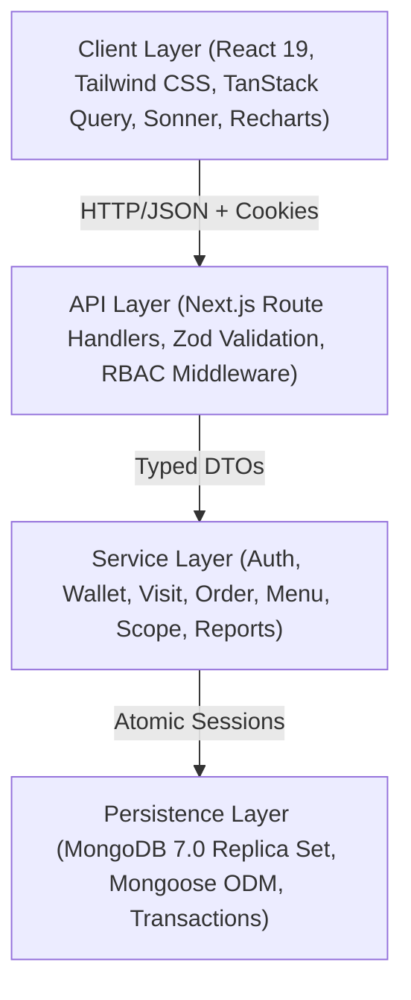

# Unifi Cafe — Enterprise Multi-Location Cafe Membership & Franchise SaaS

[](https://nextjs.org/)
[](https://react.dev/)
[](https://www.typescriptlang.org/)
[](https://www.mongodb.com/)
[](https://tailwindcss.com/)
[](#)

Unifi Cafe is a production-grade, multi-tenant cafe membership, contactless smart card access, wallet ordering, and franchise operations platform built for physical cafe chains across India.

---

## 🌟 Executive Summary

Unifi Cafe eliminates checkout friction and enables seamless cross-cafe co-working and dining experiences. Members subscribe to an all-inclusive prepaid membership, receive a digital and physical NFC/RFID smart card, tap into any registered cafe branch, and order gourmet meals and beverages straight from their wallet points.

### Core Business Model

- **Membership Recharge:** ₹5,000 per cycle.
- **Points Credited:** 5,000 Points per recharge (1 Point = ₹1 INR).
- **Points Rule:** Points carry forward across recharges indefinitely; debit/credit ledger is immutable.
- **Cafe Usage Hours:** 150 Hours (9,000 minutes) granted per recharge.
- **Hours Rule:** Hours reset back to 150 on every successful recharge.
- **Access Protocol:** Physical or digital NFC/RFID tap at the reception/entry turnstile.
- **Zero-Hours Safety Rule:** A customer with 0 remaining hours is blocked from entering any cafe, but is **always permitted to exit** an ongoing session without being trapped.
- **Order Model:** In-cafe dine-in ordering or pre-arrival pick-up ordering using wallet points. **No home delivery.**

---

## 🏗️ Architecture & Technology Stack

Unifi Cafe is structured as a unified Next.js App Router full-stack monolith designed with clean architectural layers:



### Stack Highlights

- **Framework:** Next.js 15.5.28 with React 19 (App Router).
- **Language:** TypeScript 5 with strict null-checks and zero compiler warnings.
- **Database:** MongoDB 7.0+ with Mongoose ODM (fully supporting multi-document ACID transactions).
- **Authentication:** HS256 JWT tokens with sliding-window sessions delivered in secure, HTTP-only, SameSite cookies.
- **Payments:** Razorpay Payments Gateway REST API integration with HMAC-SHA256 server-side signature verification + Instant Demo Mode bypass.
- **UI System:** Tailwind CSS v4, Lucide React icons, Radix UI primitives, Recharts analytics, Sonner notifications.
- **Validation:** Shared Zod schemas ensuring end-to-end type safety from form inputs to Mongo documents.

---

## 🔑 Demo Accounts & Instant Access

All accounts are pre-seeded and ready to use immediately:

| Role | Email | Password | Access Portal | Description |
| :--- | :--- | :--- | :--- | :--- |
| **Super Admin** | `admin@unificafe.demo` | `Admin@123` | `/admin/dashboard` | Unrestricted global access, financial analytics, audit logs, system settings |
| **Area Supervisor** | `supervisor@unificafe.demo` | `Demo@123` | `/supervisor/dashboard` | Scoped monitoring across Bangalore assigned cafes |
| **Franchise Owner** | `owner@unificafe.demo` | `Demo@123` | `/franchise/dashboard` | Franchise cafe analytics, sales, staff roster, local menu requests |
| **Cafe Manager** | `manager@unificafe.demo` | `Demo@123` | `/manager/dashboard` | Real-time shift management, order dispatch, menu toggle, attendance |
| **Cafe Staff** | `staff@unificafe.demo` | `Demo@123` | `/staff/scan-card` | Interactive NFC/RFID terminal simulator, card issuance, order fulfillment |
| **Customer** | `customer@unificafe.demo` | `Demo@123` | `/customer/dashboard` | Points balance, remaining hours, digital card, food ordering, visit history |

---

## ⚡ Quick Start

### 1. Prerequisites

- **Node.js**: v18.18.0 or later (v20+ recommended).
- **npm** or **pnpm**.
- **MongoDB**: MongoDB 6.0+ (replica set mode recommended for transactions).

### 2. Installation

```bash
git clone https://github.com/your-org/unifi-cafe.git
cd unifi-cafe
npm install
```

### 3. Environment Setup

Create `.env.local` from the provided example:

```bash
cp .env.example .env.local
```

### 4. Start the Database & Seed Demo Data

Unifi Cafe includes an embedded, high-performance MongoDB Replica Set runner. If you do not have an external MongoDB server running, start the local database:

```bash
# Terminal 1: Start persistent local replica set on port 27017
npm run db:local
```

In a second terminal, populate the database with complete demo fixtures:

```bash
# Terminal 2: Seed 6 demo accounts, 5 cafes, 42 menu items, 20 customers, 32 orders
npm run seed
```

### 5. Launch the Application

```bash
npm run dev
```

Open [http://localhost:3000](http://localhost:3000) in your web browser.

---

## 🧪 Testing

Execute the automated end-to-end business logic verification suite covering all 24 mandatory requirements:

```bash
npx tsx tests/run-tests.ts
```

The test runner spins up an isolated, transient MongoDB memory replica set and validates:
1. Customer registration, email uniqueness, bcrypt password hashing, and login.
2. Membership purchase crediting ₹5,000 = 5,000 points and 150 hours (9,000 minutes).
3. Webhook idempotency preventing duplicate crediting.
4. Points carry-forward and hours reset across consecutive recharges.
5. Razorpay HMAC-SHA256 signature verification.
6. NFC/RFID smart card tap entry, duplicate tap blocking, zero-hours entry denial, and zero-hours safety exit.
7. Wallet balance verification, insufficient points rejection, atomic debit, and order cancellation refunds.
8. Area supervisor role-based cafe scoping and unauthorized cafe blocking.

---

## 📚 Complete Project Documentation

Detailed technical documentation is provided in the project repository:

- 📖 [**Setup & Installation Guide**](./SETUP.md): Step-by-step installation, MongoDB replica set setup, environment variables, production deployment.
- 🔌 [**REST API Documentation**](./API_DOCUMENTATION.md): All 35+ REST endpoints with HTTP methods, RBAC scopes, request payloads, and response schemas.
- 🗄️ [**Database Architecture**](./DATABASE_SCHEMA.md): Complete MongoDB collection schemas, indexes, validation rules, and relationship diagrams.
- 👥 [**Demo Data & Workflows**](./DEMO_DATA.md): Account credentials, seeded entities, cafe locations, and user tour guidelines.
- ⚙️ [**Environment Variables**](./ENVIRONMENT_VARIABLES.md): Detailed specification of configuration keys and production values.
- 🛡️ [**Testing Guide**](./TESTING.md): Test suite execution instructions and test case mapping.

---

## 📄 License

Proprietary — Developed for Unifi Cafe Multi-Location Cafe SaaS Platform.

